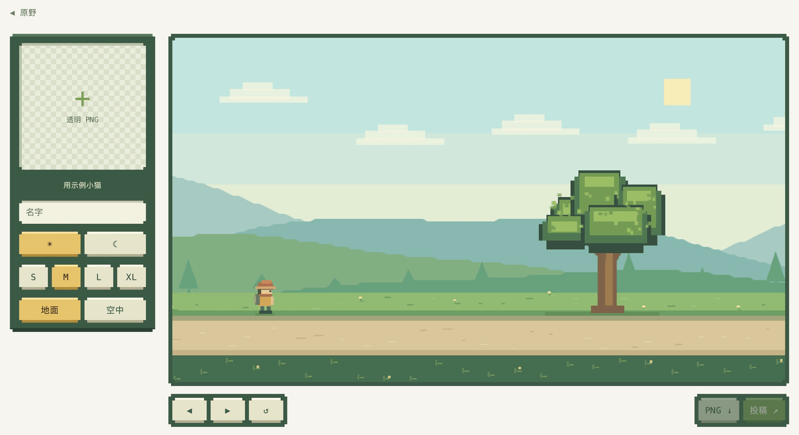
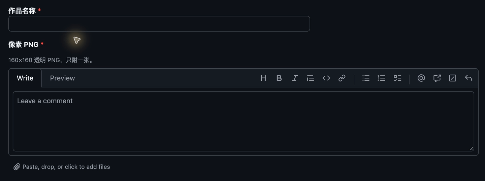
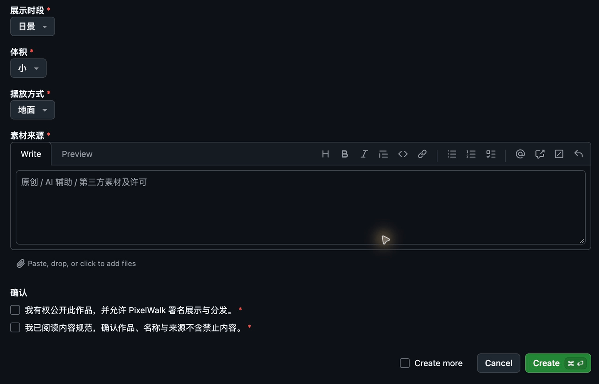

# 把你的风景放进 PixelWalk

**简体中文** · [English](CONTRIBUTING.en.md) · [返回首页](README.md)

一棵树、一只猫、一栋小屋，或一件你想让旅人偶然遇见的东西。你可以用图片创作，不需要改代码。

[打开创作页](https://jilinjl.github.io/PixelWalk/#/contribute) · [查看投稿](https://github.com/JilinJL/PixelWalk/issues?q=is%3Aissue+label%3Ascenery) · [内容规范](docs/zh-CN/content-policy.md)

**只有“内容审核通过 + 图片校验通过 + 网站部署成功”，创意才会进入公开游戏。** 图中示例小猫只演示操作，不代表新投稿已经被收录。

## 1. 准备一张图片

打开「参与设计」，点击左侧的 **＋ 透明 PNG**，或把图片拖进格子。第一次使用可以点击「用示例小猫」熟悉操作。

| 你准备的原图 | 实际投稿的文件 |
| --- | --- |
| 透明 PNG 或 WebP | 从创作页下载的透明 PNG |
| 最多 8 MB、1600 万像素，非动图 | 160×160，最多 1 MiB，非动图 |
| 主体完整、轮廓清楚、背景透明 | 有可见像素，至少 1% 透明区域 |

只投稿你有权公开展示、修改和分发的内容。原创、AI 辅助或已获许可的素材都应说明来源；AI 生成并不免除内容和权利审核。不要上传证件、私人照片或联系方式。

## 2. 调整效果，走近看看

图片会自动变成像素风。填写作品名，再选择时段、体积和摆放方式；右侧可立即看到结果。

| 画面中的控件 | 怎么用 |
| --- | --- |
| 名字输入框 | 给作品起一个简短、清楚的名字 |
| ☀ / ☾ | 选择日景或夜景 |
| S / M / L / XL | 选择在游戏中的体积 |
| 地面 / 空中 | 选择摆放方式，避免主体位置不合理 |
| ◀ / ▶ / ↺ | 后退、前进、重新试玩，也可使用 A / D 或方向键 |
| PNG ↓ | 单独下载最终 PNG |
| 投稿 ↗ | 下载 PNG，同时打开预填的 GitHub 表单 |

重点检查：主体是否完整、透明背景是否干净、大小是否合适、人物走过时效果是否自然。试玩不会自动投稿，刷新也不会保留当前创作，请下载保存。

## 3. 把下载的 PNG 附进 Issue

点击「投稿 ↗」，登录 GitHub。作品名和展示选项通常会预填；**图片不会自动上传**，你需要把刚下载的 PNG 拖进「像素 PNG」输入区域，等待附件上传完成。

请确认只附 **一张最终 PNG**，不要把原始大图、WebP 或整张游戏截图当作投稿文件。附件上传后可以切换 **Preview** 检查是否显示图片；不要只填一个本地文件路径。

若直接打开[风景投稿表单](https://github.com/JilinJL/PixelWalk/issues/new?template=scenery.yml)，还需手动填写作品名、展示时段、体积和摆放方式。

## 4. 写清来源，确认后提交

向下滚动，填写「素材来源」，阅读并勾选两项确认，最后点击 GitHub 的 **Create** 按钮。提交后的 Issue 与附件公开可见，署名使用你的 GitHub 账号。

来源说明应让维护者判断你是否有权投稿。例如：

- **原创：** “由我绘制，允许 PixelWalk 以我的 GitHub 账号署名展示与分发。”
- **AI 辅助：** “使用某工具生成，随后由我调整；已检查使用条款与作品内容，允许署名展示与分发。”
- **第三方素材：** 提供作者、原始链接、许可名称，以及允许修改和再分发的依据。

只写“来自网上”、物体名称或“AI 图片”，通常不足以完成来源审核。两项确认分别是公开展示与分发授权，以及已阅读内容规范；请在自己确实同意并满足要求后勾选。

## 5. 什么情况下会被加入游戏

| 条件 | 维护者会检查什么 |
| --- | --- |
| 内容合适 | 适合安静的像素漫游，不含色情、血腥暴力、政治敏感宣传、仇恨、违法、隐私或恶意链接等[禁止内容](docs/zh-CN/content-policy.md) |
| 来源与权利清楚 | 能说明作者、创作方式或许可，有权公开展示与分发 |
| 视觉效果合适 | 主体清楚、透明背景干净，所选时段、大小和位置与预览相符 |
| 文件与表单有效 | 一张合规 PNG、必填信息完整、两项确认已勾选 |
| 有维护者批准 | 有 write / maintain / admin 权限的协作者人工审核并执行 `/approve`；普通评论或点赞不会自动批准 |
| 正式部署成功 | 批次发布成功，Issue 获得 `published` 标签并由机器人发布成功评论、关闭 |

符合文件要求不代表一定收录。维护者也会判断风格适配、来源可靠性与内容风险；有疑问会要求补充说明或修改。

## 6. 怎么知道现在到哪一步了

**提交 → 待审核 → 批准入队 → 批量部署 → 已发布**

| Issue 状态 | 现在意味着什么 | 你需要做什么 |
| --- | --- | --- |
| `pending-review` | 已收到，等待人工检查 | 等待维护者反馈 |
| `needs-changes` | 需要修改或补充信息 | 编辑原 Issue，修正图片或说明后回复维护者，请求重新审核 |
| `approved` | 通过审核并进入队列 | 等待部署，暂时还不能认为已经上线 |
| `published`，并有机器人发布成功评论、Issue 关闭 | 网站部署已成功确认 | 刷新游戏页面，再在对应日夜风景中遇见作品 |

发布任务约每 **30 分钟** 检查一次，GitHub 调度和部署可能延迟，没有“审核后立即上线”的保证。作品会参与对应日景或夜景的选择，不保证第一屏就出现；已打开的游戏不会自动拉取刚上线的目录；单点「重新出发」仍使用已载入的目录，需要刷新页面才能获取新收录作品。投放后，你的 GitHub 账号也会加入木屋鸣谢。

单独关闭 Issue 不等于上线或取消排队，请同时看标签和机器人评论。

## 常见问题

**编辑 Issue 后，队列里的图片会跟着变吗？** 不会。审核保存的是快照；尚在队列中的作品需要维护者重新批准。要阻止旧版本发布，请先请维护者退回，不能只替换附件或关闭 Issue。

**机器人提示“无法通过”怎么办？** 看评论中的具体原因，检查下载的 PNG、完整表单和来源说明。修正后在原 Issue 请求维护者重新执行 `/approve`，不要反复创建相同投稿。

**不通过或想撤回怎么办？** 可以补充来源、修改作品，并请求另一位维护者复核。尚未投放的作品由维护者退回；已经进入发布候选或上线的作品按[投放与下架说明](docs/zh-CN/publishing.md)处理。

**能自己给自己批准吗？** 普通投稿者不能。仓库管理员在代码中有自审例外，但仍建议交给其他协作者检查。

## 维护者与开发者

人工审核命令为 `/approve` 和 `/reject 理由`。权限、快照、标签与恢复细节见[审核逻辑](docs/zh-CN/moderation.md)和[投放逻辑](docs/zh-CN/publishing.md)。本地开发命令见[首页](README.md#在本地运行)。

截图采集自实际游戏与 GitHub 表单，使用内置示例；为了说明流程，没有创建或批准演示投稿。
