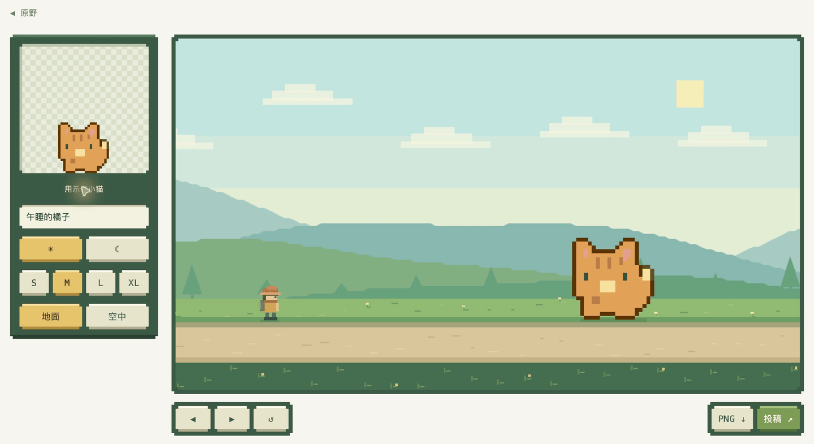

# PixelWalk

**简体中文** · [English](README.en.md)

走一段路，看一处风景。一个有日夜、月相和小小彩蛋的像素漫游世界，也欢迎你为它画下一处风景。

[开始漫游](https://pixelwalk.fun/) · [贡献一处风景](CONTRIBUTING.md) · [玩法指南](docs/zh-CN/gameplay.md)


## 这里有什么

- **安静地走。** 没有分数、战斗或通关压力，按住方向键就出发。
- **看日夜变化。** 每五处风景切换日夜；走过完整一晚，月亮推进一个形态。
- **找一点惊喜。** 开局向左探索木屋，打开作者与社区贡献者的鸣谢画卷。
- **留下你的创意。** 把图片转换成像素风景、放进原野试玩，再提交给社区审核。

## 怎么玩

| 想做什么 | 操作 |
| --- | --- |
| 向前走 | 按住 **D / →**，松开停止 |
| 开局向后走 | 按住 **A / ←**；通过首景后不能倒退 |
| 手机行走 | 按住画面右侧前进，左侧三分之一后退 |
| 自动漫游 | 点击顶部「沉浸」，再按 D / →，手机点击画面 |
| 停止自动漫游 | **Esc** 或双击画面；手机双击 |
| 音乐与音量 | 顶部 **BGM** 开关，**ⓘ** 查看来源和调节音量 |

月相按 **新月 → 上弦月 → 满月 → 下弦月 → 新月** 循环。刷新或点击「重新出发」会重置旅程。[查看完整操作与彩蛋](docs/zh-CN/gameplay.md)。

## 让你的风景进入游戏



**创作与试玩 → 提交 Issue → 维护者人工审核 → 批量部署 → 出现在大家的旅程里。**

不需要会写代码。[图文贡献指南](CONTRIBUTING.md) 会带你完成选图、下载 PNG、填写投稿表单和查看审核状态。

作品需要来源清楚、允许公开展示与分发、符合[内容规范](docs/zh-CN/content-policy.md)，并通过图片校验。只有维护者批准且网站部署成功后才会上线；本地试玩、下载图片或提交 Issue 都不等于已经收录。

## 按需阅读

| 文档 | 你会找到什么 |
| --- | --- |
| [贡献指南](CONTRIBUTING.md) | 带截图的投稿步骤、收录条件、状态说明与常见问题 |
| [玩法指南](docs/zh-CN/gameplay.md) | 完整操作、日夜月相、木屋彩蛋、音乐 |
| [内容规范](docs/zh-CN/content-policy.md) | 色情、暴力、政治敏感、侵权、隐私、恶意链接等禁止内容 |
| [审核逻辑](docs/zh-CN/moderation.md) | 审核权限、命令、图片快照和技术校验 |
| [投放逻辑](docs/zh-CN/publishing.md) | 定时发布、手动投放、失败恢复和下架 |
| [托管现状](docs/zh-CN/deployment.md) | GitHub Pages、图片存储与自定义域名 |
| [检查记录](docs/zh-CN/automation-audit.md) | 自动化检查证据与验证边界 |

## 在本地运行

需要 **Node.js 24+** 和 **Python 3**，无需安装 npm 依赖或配置外部 API。

```sh
npm run dev         # 打开 http://127.0.0.1:5173
npm test
npm run build:site  # 静态站点生成到 dist/
npm run build       # 单文件生成到 outputs/PixelWalk-demo.html
```

离线 HTML 是构建产物，不是仓库自带下载。`content.js` 由 `scenery/manifest.json` 生成，正常投稿时由工作流维护。

## 音乐与鸣谢

白天配乐 **Childhood**、夜晚配乐 **Moonlight**，均由 **Scott Buckley** 创作，采用 **CC BY 4.0**。见[完整来源、署名与转码说明](assets/audio/LICENSE.md)。社区作品按 GitHub 账号署名，投放后加入木屋鸣谢。
