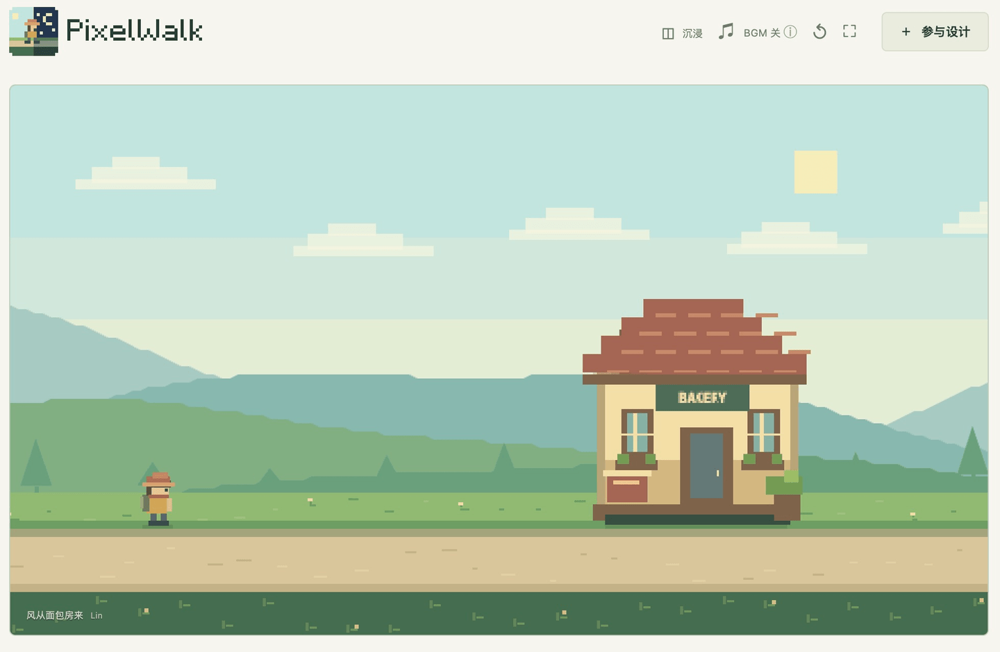

# PixelWalk

**简体中文** · [English](README.en.md)

走一段路，看一处风景。

[开始漫游](https://pixelwalk.fun/) · [贡献一处风景](CONTRIBUTING.md)



## 留下一处风景

把你的创意变成原野中的一处风景。无需编程，在创作页选图、试玩，再按[贡献指南](CONTRIBUTING.md)投稿。

作品需来源清楚、允许公开展示与分发，并符合[内容规范](docs/zh-CN/content-policy.md)。审核与发布流程见[审核说明](docs/zh-CN/moderation.md)和[投放说明](docs/zh-CN/publishing.md)。

## 本地运行

需要 Node.js 24+ 和 Python 3，无需安装 npm 依赖。

```sh
npm run dev         # http://127.0.0.1:5173
npm test
npm run build:site  # dist/
npm run build       # outputs/PixelWalk-demo.html
```

## 音乐

**Childhood** / **Moonlight** — **Scott Buckley**，**CC BY 4.0**。[来源与署名](assets/audio/LICENSE.md)。
