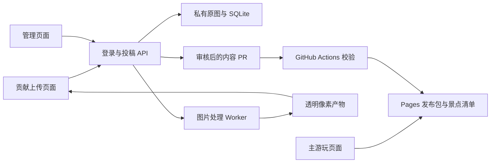

# EndlessWalk / PixelWalk 开发文档

版本：v1.0 设计基线<br>
日期：2026-10-15（Asia/Shanghai）<br>
产品名称：EndlessWalk<br>
工程与拟定仓库名称：PixelWalk<br>
GitHub 仓库所有者：JilinJL（2026-10-15 用户指定）<br>
状态：开发前规格。本文定义要实现的行为、接口、流程和验收条件，不代表功能已实现或部署。

## 1. 产品目标与范围

EndlessWalk 是一个社区共同建设的 2D 横版像素漫游游戏。玩家按住 D 或右方向键前进，角色保持在屏幕固定位置，景色向左移动。景点来自经过审核的用户图片，按照日夜标签和随机规则持续出现。每走过五个景点切换一次时间。出生点左侧的小木屋展示作者与已收录参与者的名字。

第一版要验证两个体验：玩家愿意继续看下一个景点；普通用户可以通过上传一张图片，在短暂试玩后完成贡献。

### 1.1 已确认需求

| 编号 | 需求 | 实现约束 |
| --- | --- | --- |
| R01 | 精致像素风，社区共创景色 | 统一像素颗粒、摆放规则、地面与远景 |
| R02 | 用户上传单张图片 | 不要求视频、24 帧、绿幕或自行抠图 |
| R03 | 上传时选择日景/夜景及小/中/大/巨大 | 时间与体积是作品元数据 |
| R04 | 投稿页包含像素化预览与短暂试玩 | 使用正式渲染引擎和正式摆放逻辑 |
| R05 | 用户不能修改像素化算法参数 | 参数由 JilinJL 管理 |
| R06 | 固定速度按住 D/→ 向右走，松开停止 | 速度不受屏幕尺寸、刷新率或键盘重复率影响 |
| R07 | 角色相对屏幕位置不变，景色靠近 | 角色仍有行走/待机动作 |
| R08 | 每经过五个景点切换日夜 | 稳定日间从日景池取材，稳定夜间从夜景池取材 |
| R09 | 出生点左侧木屋展示参与者 | 木屋是主页面内的近景与面板，不增加第四个页面 |
| R10 | 经过第一个景点后不能往左走 | 此前可返回木屋；之后只允许停止或向右 |
| R11 | 未审核通过的作品不得进入景点库 | 审核、发布、实际线上可见是不同状态 |
| R12 | 只有主游玩、贡献上传、管理三个页面 | 登录、审核详情、设置使用页内区块或弹层 |
| R13 | 管理页仅本人或仓库协作者可用 | 服务端鉴权；配置参数仅本人可修改 |
| R14 | 使用 JilinJL 的 GitHub 仓库与发布管线 | 内容进入游戏必须经过校验与发布流程 |
| R15 | 及时清理走过的景色 | 场景数量、位图缓存和请求并发均有上限 |
| R16 | 环境可有动画，作品动画以后再加 | 第一版作品本身静态 |
| R17 | 未来支持沙漠、丛林、冰原等环境 | 第一版统一环境，数据结构预留环境字段 |

### 1.2 第一版范围

交付三个页面、一个统一环境的日夜版本、固定角色与行走动作、背景视差与环境动态、透明像素素材处理、投稿试玩、GitHub 登录、待审队列、作品管理、所有者参数管理、GitHub 内容 PR 与 Pages 发布、参与者木屋。

视频上传、24 帧投稿、作品内部动画、多人联机、战斗、跳跃、碰撞解谜、排行榜、任务、经济系统不进入第一版。前文讨论的“3 秒播放完成”属于视频版本，不再约束当前静态图片的行走时间。

### 1.3 本文采用的执行默认值

下文的技术栈、尺寸、速度、缓存和处理参数是为了让开发能直接启动而给出的默认设计，不是用户已经逐项确认的数值。它们集中配置并由所有者调整。正式默认值在美术样片验证后确定。

## 2. 核心体验与世界组织

### 2.1 世界模型

世界按横向坐标延伸。玩家有世界坐标 playerWorldX，用于距离与计数；角色绘制坐标 playerScreenX 固定。场景屏幕坐标按以下公式求得：

```text
screenX = sceneWorldX - playerWorldX + playerScreenX
```

左右移动只是改变世界坐标，角色绘制位置不随之平移。地面、主要景色和不同视差层根据同一位移更新。

### 2.2 景点与图片的关系

一个景点是一个固定长度的道路单元，包含一件主要社区作品以及系统装饰。主要作品大小不同，但景点计数相同。

正方形是透明素材的统一容器，不是游戏里可见的画框。天空、远山、道路由游戏统一提供，作品只保留主体及需要保留的内部细节。

```text
远景天空与山 ─────────────────────────────
                      [透明画布中的树]
      玩家            [透明画布中的小店]
道路与接地细节 ───────────────────────────
```

小物体所在路段可以出现草、石块等系统装饰，但这些不计入“景点”，也不增加主要作品数量。所有投稿作品第一版都不参与物理碰撞。

### 2.3 初始布局与回头限制

世界从出生点 x=0 开始，左侧安排木屋，右侧安排第一个正式景点。第一景点完成之前，允许 A/← 和 D/→；完成之后 permanentlyForward=true，A/← 不再改变世界坐标。

“走过景点”统一定义为 playerWorldX >= scene.passX，其中 passX 为该景点正方形区域的右边界。使用固定区域边界，不根据猫、树等实际透明内容的宽度改变计数条件。

每个景点保存 passed 标记。一个景点只能计数一次，即便玩家在第一个景点前来回走动。首次计数发生的同一逻辑步立即锁定向左移动。已通过景点不再回到玩家前方。

正向锁定前不得回收返回出生点所必需的道路与首景点实例；可释放位图后按相同实例 ID 重载，不能重新随机一个不同首景点。第一景点计数后即可按正常规则释放身后内容。

### 2.4 距离、时间与动画

新增景点、景点经过、日夜开始切换、木屋进入/退出、未来作品事件，均由世界位置或距离决定。环境草叶、云层和玩家待机等装饰性循环可以按时间播放，它们不触发新的玩法事件。

角色行走动画跟随移动距离，松开后切换待机。场景主体保持静态，不把所有楼房、邮箱等统一摇摆。夜间系统灯光与星星允许循环动画，但不得因此改变作品审核状态或景点计数。

## 3. 页面与信息架构

前端采用 Hash 路由，适配 GitHub Pages 项目子路径。仅存在以下三个产品页面：

| 页面 | 逻辑路由 | 默认公开性 |
| --- | --- | --- |
| 主游玩页面 | /#/ | 公开，无需登录 |
| 贡献上传页面 | /#/contribute | 页面公开；服务器处理与正式投稿需要 GitHub 登录 |
| 管理页面 | /#/admin | 需通过仓库身份与权限校验 |

OAuth 回调、图片资源、接口地址属于技术端点，不计入产品页面数量。作品详情、审核、配置、投稿历史都在三个页面内部展示。

### 3.1 主游玩页面

主体是尽可能完整的游戏画面。右上角始终提供“参与设计”；通过鉴权的管理者可见“管理”。少量辅助信息可包括当前日夜、已经过景点数、当前作品名与作者。避免把任务面板、计时奖励等加入主体验。

首次进入显示操作提示：“按住 D 或 → 向前。出发前也可以往左看看。”第一次锁定向左移动时提示一次“旅程继续向前”，随后不重复打扰。

按键仅在游戏画布获得交互焦点时生效；文本输入、文件选择、弹层操作不应带动角色。阻止游戏焦点内方向键滚动页面。blur、visibilitychange、路由离开时清空按键状态。

移动端可提供按住前进按钮；首次景点前提供返回方向按钮，锁定后隐藏。按钮与键盘调用同一输入状态，不改变速度。横屏优先，竖屏以完整逻辑视野缩放展示并给出可关闭的横屏提示。

加载主游戏只依赖静态发布包。投稿 API 维护或故障时，已发布游戏仍可玩。

### 3.2 作者与参与者木屋

木屋处于出生点左侧。沿左侧道路靠近时镜头逐渐拉近，达到入口距离后显示屋内面板。面板包含作者“我 / JilinJL”、项目说明、所有已公开收录参与者的展示名与 GitHub 名称。

镜头变化由木屋入口区间的距离进度控制。进入面板后，右向移动返回道路；名字列表可以滚动，不增加独立页面。木屋内不计景点，也不推进日夜组计数。

参与者数据取自随发布包生成的 contributors.json，不从“给代码提交过 commit 的所有账号”直接推断。按 GitHub 数值用户 ID 去重，展示名安全渲染。普通作品归档后保留贡献署名；未通过、仅试玩、发布失败作品不进入名单。

首版刷新会开始新旅程，回到出生点，因此可以再次访问木屋。不实现自动恢复到数公里之外的进度；如果未来加存档，另行解决回看木屋入口。

### 3.3 贡献上传页面

页面按“上传 → 看效果 → 试玩 → 提交”的顺序渐进展示。第一屏只解释图片、日夜、体积，不先展示技术设置。

用户必填内容：一张图片、日景/夜景、小/中/大/巨大。作品名可自动填入“某某的风景”，署名默认 GitHub 名称并可修改。可选“空中物体”开关用于飞机、热气球、UFO；不开启时贴地。不要要求用户填写具体坐标、抠图阈值或像素分辨率。

后续环境选择预留字段，但第一版仅显示“原野”，不用空选项诱导用户以为沙漠等已开放。选择器仅在确有完整环境与素材池后出现。

处理成功后显示三种同一版本的视图：原图、透明像素结果、实际游戏中的试玩。透明结果可以带棋盘背景辅助查看，但导出图本身不得包含棋盘格。

贡献者只能改作品信息和预设分类，不能调色板、色数、抖动、阈值、格子尺寸、精确摆放坐标或移动速度。不在客户端藏一组仍可提交生效的高级参数。

### 3.4 管理页面

使用页内标签组织以下内容，不增加路由页面：

| 区块 | 功能 |
| --- | --- |
| 待审列表 | 筛选、分页、原图/结果对比、正式引擎试玩、审核意见 |
| 作品库 | 新增、修改、替换图片、归档、恢复、查看发布版本 |
| 像素化设置 | 所有者编辑；协作者只读 |
| 游戏设置 | 所有者编辑移动速度、显示与环境参数 |
| 发布状态 | 内容 PR、检查、部署、线上验证、失败重试、回滚 |
| 操作记录 | 审核人、修改前后版本、时间、原因、GitHub 关联 |
| 接入状态 | GitHub 权限、处理队列、模型可用状态、未来 Issue 适配器 |

待审详情必须同时显示源图、透明效果、日夜背景、体积分档、放置层、作者、处理参数版本、文件哈希、投稿者最后确认的试玩版本。管理员修改图片或摆放后必须重新预览，旧审核决定失效。

协作者可调整作品的名称、日夜、体积、地面/空中归属，按当前正式参数重新处理，审核、发布、归档作品；不能以“修一件作品”为由覆盖像素化算法数值。需要特殊算法处理时交由所有者。

删除默认执行可恢复归档：从下一发布版本的景点库排除，保留原始记录与署名。物理清理原图、撤销署名或清除历史由所有者单独执行，并记录原因。

## 4. 投稿与短暂试玩的完整流程

### 4.1 用户流程

1. 从主页面右上角进入贡献页面。
2. 选择图片并填写日夜、体积，可选空中摆放。
3. 使用 GitHub 登录后，上传到 API；原始文件不直接进入公开 Git 仓库。
4. 服务端校验图片、创建处理任务并返回进度。
5. 任务完成后返回透明像素图、摆放元数据和不可变 previewRevision。
6. 页面打开短途试玩，候选作品固定出现在前方；按住 D/→ 可以从前面经过它。
7. 不满意可替换原图、改变分类或返回修改展示信息；系统自动生成相应新版本。
8. 满意后确认“已查看实际展示效果”，点击提交审核。
9. 页面显示待审核状态，用户无需手动创建 Issue、编写 JSON 或发 PR。

上传与处理是显式用户动作，不因切换标签、打开页面或角色行走自动发起。处理服务失败可重试，不把白底原图偷偷当作处理成功的透明结果。

### 4.2 试玩的具体规则

试玩复用主游戏的 GameEngine、SceneRenderer、PlacementResolver、输入和资源管理组件。通过 PreviewScenario 注入候选作品及固定前后装饰，禁止复制一套外观近似但摆放计算不同的引擎。

短途试玩默认约 8–12 秒持续步行可经过候选物；这个时长不是投稿视频时长，也不是必须等待的倒计时。用户可随时停止、重置或退出。第一版不需要自动行走。

候选作品固定出现，不依靠随机抽取；环境与用户选择的日夜一致。显示正式配置下的像素大小、地面、角色比例、遮挡顺序和空中高度。试玩不累计正式旅程计数、不进入参与者名单、不写公共景点库。

### 4.3 版本一致性

每次源图、日夜、体积、放置方式或处理参数版本改变，生成新的 previewRevision。提交请求必须引用最新且成功的处理产物。

提交时服务端校验：图片归属当前用户；处理成功；元数据版本一致；试玩确认引用同一 previewRevision；使用的是当前有效的投稿处理配置。旧版本返回 409 并引导重新处理和试玩。

试玩确认是一份“用户确认了这个版本”的记录，不宣称服务端能证明用户实际观看了每一秒。

审核只针对明确的 artworkRevision。批准后冻结该版本的图片、尺寸、摆放与参数快照；发布不能悄悄用另一份刚处理的新图替换它。

## 5. 素材体积、位置与透明画布

### 5.1 默认坐标规范

以下是可用于样片的逻辑尺寸，配置版本由所有者管理：

| 项目 | 初始建议值 | 说明 |
| --- | --- | --- |
| 游戏逻辑视野 | 960 × 540 | 浏览器缩放不改变世界单位 |
| 地面基线 | y=432 | 地面以下保留近景空间 |
| 角色固定位置 | x=144，脚底 y=432 | 角色约 48 高 |
| 每件作品的逻辑容器 | 320 × 320 | 透明正方形，不显示边框 |
| 标准像素步长 | 2 个世界单位 | 对应素材网格 160 × 160 |
| 普通景点步距 | 480 世界单位 | 320 展示区域与 160 连接段 |
| 固定移动速度 | 80 世界单位/秒 | 持续走过普通景点步距约 6 秒 |
| 空中物体默认抬升 | 96 世界单位 | 最大素材仍在逻辑视野内 |

### 5.2 四档体积

| 档位 | 主体包围盒最大边，世界单位 | 相应像素边长上限 | 示例 |
| --- | --- | --- | --- |
| small | 64 | 32 | 猫、邮箱 |
| medium | 128 | 64 | 马、中型动物或物件 |
| large | 224 | 112 | 小店、大树 |
| giant | 320 | 160 | 大楼、大型雕像、飞机、热气球、UFO |

按主体包围盒最大边等比适配，不能拉伸成正方形。体积不是重量、碰撞体或稀有度。飞机和热气球是否悬空由 placement.kind 决定，不能从 giant 自动推断。

源图本身不要求正方形，系统把主体规范到统一透明方形画布，减少用户裁图负担。主体默认底部居中；空中素材在整个画布位置上抬，不逐像素猜测地面。用户无需提供锚点，审核者通过分类与预览修正。

### 5.3 透明与接地

输入已有有效透明度时，默认保留源 Alpha；完全不透明的图自动去背景。如何判断有效透明度、是否允许半透明，均由所有者配置，不交给普通投稿者调参。

空隙应透明，物体内部应按画面含义保留。打开的窗户如果后面是室内，不应机械地变成可看见远山的洞。烟、玻璃等复杂半透明作品先进入人工检查，不承诺自动推断正确。

绘制顺序：天空 → 云与远山 → 远处装饰 → 社区主要作品 → 玩家 → 少量前景草叶。第一版投稿物体统一位于玩家后方，避免巨型物体挡住角色和操作提示。

接地阴影只对地面作品启用，由统一样式生成，强度要轻。空中作品默认无接地阴影。地面草叶可以遮住主体底部少量像素，不能盖住邮箱主体或动物脚部。

## 6. 像素化与去背景管线

### 6.1 参考工具的采用方式

参考 [MakeBead 像素画转换器](https://makebead.com/zh-Hans/pixel-art-converter/) 的“导入图片 → 网格降采样 → 限色 → 可选抖动 → 透明 PNG”体验。本文参考公开页面功能，不假设其内部算法、源代码或对外 API 可用，不把第三方网站作为生产转换依赖。

参考页面保留透明度的能力不等同于自动去背景。项目必须自行实现背景移除、统一摆放和审核。

### 6.2 服务端权威流程

```text
原始图片
  → 文件与像素数量检查、解码、EXIF 方向修正
  → 规范为 sRGB RGBA、剥离不需要的元数据
  → 保留已有 Alpha / 执行自动去背景
  → 检查主体与透明边缘
  → 求主体包围盒、等比缩放到体积分档
  → 放入统一透明方形画布
  → 降采样到统一像素网格
  → 只依据有效前景生成或匹配色板
  → 减色、可选抖动、恢复透明度
  → 编码 PNG、生成缩略图与参数快照
  → 计算文件哈希、输出预览版本
```

抠图必须发生在低分辨率像素化之前，避免主体与背景在边缘先混色。缩放时妥善处理预乘 Alpha 或进行等效的颜色去污染，防止黑边、白边。透明区域的 RGB 不参与前景色板统计，错误的透明底色不得污染整张图。

最终生成固定 160 × 160 的 RGBA 素材，游戏以 320 × 320 的逻辑容器绘制；不同体积通过容器内主体占用面积体现。该规则避免每个档位出现不同大小的像素颗粒。像素步长变化时，容器和处理输出同时按新配置计算。

第一版硬表面素材默认采用二值透明边缘，保留半透明作为所有者可控选项。无需引入拼豆色号、可打印网格或 PDF 导出。

### 6.3 去背景实现

建议后端通过 BackgroundRemovalProvider 接口接入 rembg/ONNX 本地图片模型。首个实现采用通用静态图片模型，先以真实素材验证；不使用仅适合人像的模型覆盖猫、房屋、树和 UFO 等全部题材。

模型固定版本与文件校验和，构建或运维阶段预先下载，首次用户投稿不临时下载数百 MB 模型。处理在独立 worker 中执行，API 进程不承担推理计算。

去背景失败、前景几乎为空、明显切掉主体、输出仍为整块背景时，进入 needs_fix 或 processing_failed，不进入可投稿成功状态。修正由审核者或所有者处理；用户可替换图片，但不被要求手工制作 24 帧或安装工具。

管理页提供保留原始 Alpha、按同一正式预设重试、替换已修正透明图的能力。调整模型、阈值等算法参数仅限所有者。

### 6.4 参数与确定性

PixelPreset 至少包含 pipelineVersion、模型名称/版本/校验和、像素步长、最大颜色数、色板策略、日夜色板版本、抖动方式、Alpha 策略与边缘阈值。

第一版建议：像素步长 2、最多 32 色、抖动关闭、硬边透明。它们是样片起点，不能作为“已验证能达到精致美术”的结论。

同一输入、元数据与预设应得到一致结果。需要随机采样的算法固定种子。缓存键包括规范化源图哈希、体积、放置分类、日夜、完整 PixelPreset 哈希和代码版本。

预览与正式发布使用同一份服务端处理产物。前端可即时预览原图的大小，但不能把客户端快速缩略结果当作最终审核素材。

### 6.5 参数修改的影响

1. 所有者创建配置草稿，在管理页对代表性样图预览。
2. 投稿处理参数切换前，把新预设状态设为 processing，阻止新旧结果混淆。
3. 新预设就绪后成为 activeSubmissionPreset；此前未提交的旧预览要求重新生成。
4. 已发布作品继续引用旧处理版本，不能因改参数静默变化。
5. 批量重处理生成新的作品修订与待审核发布批次；审核通过后原子发布新版本。

修改移动速度、日夜色彩或摆放规范同样需要生成正式 GameConfig 版本并发布。已开始的旅程固定使用进入时的 releaseId，避免走到一半速度突变。

改变像素步长、容器尺寸或锚点属于渲染协议变化，不能仅激活投稿预设就生效。必须先完成相关在库素材的批量重处理，连同兼容的 GameConfig 一起发布；新发布确认后才开放该版本的新投稿。仅改变减色/抖动等不改变摆放协议的设置，可以按新预设处理新稿件，并显式保留旧作品版本。

## 7. 日夜、随机与固定景观

### 7.1 景点计数

正常景点按 1 开始编号，1–5 属于 day，6–10 属于 night，11–15 再次 day。公式：

```text
phaseForOrdinal(n) = floor((n - 1) / 5) % 2 == 0 ? day : night
```

只有场景 passX 被首次越过才增加已通过计数。加载、进入屏幕、系统装饰、木屋、失败占位和试玩均不额外计数。内置备用景点承担正式景点位置时正常计数，不能因为它不是社区作品而卡住切换。

如果一个逻辑步越过多个边界，按顺序处理所有未计数景点，不能只更新一次。正常运行限制步长避免后台恢复后跨越大量场景。

### 7.2 日夜过渡

在每组第五个景点通过时启动距离驱动的环境过渡。明确区分 day、day_to_night、night、night_to_day 四种环境显示状态，其中过渡状态不是新的投稿标签。

第一版采用明确的过渡路段，长度初始建议 320 世界单位。天空、远山、地面、系统灯光在这个路段内插值变化，松开按键时距离进度停止。过渡路段不计为景点。

为保证“日景放白天、夜景放晚上”：上一组最后作品完全离开视野前不绘制下一组作品；过渡期间只显示系统环境与仍在离开的上一组作品；过渡完成后下一组作品才从屏幕右侧进入。禁止下一组作品已经在视野内才突然显示。

实现时以旧组尾端的 screenRight <= -recycleMargin 作为旧组离屏条件，再推进正式过渡段；下一组首个作品的 worldX 根据过渡终点和屏幕右侧生成边界计算。留白道路是有意设计的组间缓冲，不能把它误当作加载卡顿。初始阈值要在样片中验证，必要时缩短缓冲，但不能让日夜作品在稳定时段混抽。

可直接使用以下边界计算。组内普通景点仍按 stride 排列，组间不硬套同一步距：

```text
exitX = lastScene.passX + playerScreenX + recycleMargin
transitionStartX = exitX
transitionEndX = transitionStartX + transitionDistance
nextGroupFirstWorldX = transitionEndX + viewportWidth - playerScreenX + spawnMargin
```

第五个景点通过后进入“旧景退场”，此时换色进度保持 0；达到 transitionStartX 后才计算换色进度；达到 transitionEndX 后成为下一稳定时段。此时下一组首图位于屏幕右侧之外，随后随行走进入，不会弹出。组间留白会额外增加步行距离，M1 必须实际试玩并记录节奏，再决定最终参数。

候选作品的选择与网络预加载可以提前发生，绘制则必须遵守上述阶段。不同屏幕宽高采用固定逻辑视野，避免组间缓冲随窗口变化而变化。

### 7.3 随机抽取

先按 published 且未 archived、biome、phase 过滤，再执行带近期去重的随机选择。使用可复现的随机种子，便于复现坏的场景组合。

默认近期避重复数量 8；当素材池不够时逐级缩短排除列表，不无限等待。池中只有一件作品时允许重复，没有作品时使用同环境同日夜内置景点。不可用夜景作品填补日景池，也不可反过来。

近期去重以作品 ID 而不是修订 ID 为准，避免同一作品不同版本被当成两件新作品连续抽到。第一版等权抽取，不设计付费展示和复杂推荐。

### 7.4 固定景观

木屋与开场道路始终固定。预留 LandmarkSchedule，在指定景点序号插入作者制作的固定景观；固定景观占据正式景点位置时正常计数并具有对应日夜版本。缺少匹配版本时退回同池普通随机或内置备用。

同一景点可能是随机社区作品，也可能是预设地标，不能两者同时计为两个景点。地标不绕过审核、透明度与性能规则。

### 7.5 未来环境

BiomeRegistry 预留 meadow、desert、jungle、icefield 等标识。第一版仅 meadow 可选。每个开放环境需要地面、远山、天空、装饰、日夜参数、两套备用景点和至少可运行的作品池。

后续环境变化仍由距离或景点序号驱动，并通过连接路段过渡。环境与日夜是两条独立维度；切换环境不默认把日夜计数清零。

## 8. 技术架构与部署边界

### 8.1 推荐栈

| 层 | 第一版选择 | 目的 |
| --- | --- | --- |
| 前端应用 | TypeScript + Vue 3 + Vite | 三页面、表单、管理状态 |
| 游戏渲染 | Canvas 2D + requestAnimationFrame | 平移、视差、透明图片与环境动画 |
| 图像处理 | Python 3.12 + Pillow + rembg/ONNX | 统一权威处理与可替换抠图模型 |
| API | FastAPI + Pydantic | 登录、上传、审核、任务与发布 |
| 数据与队列 | SQLite WAL + SQLAlchemy；独立单 worker | 初期减少服务数量 |
| 私有文件 | API 主机持久化磁盘 | 原图、未通过素材和处理中间产物 |
| 已发布内容 | Git 仓库中的版本化 PNG 与 JSON | 可审查、可回滚、可随 Pages 发布 |
| 前端托管 | JilinJL 仓库 GitHub Pages | 静态游戏与三个页面 |
| 内容管线 | GitHub App + 内容 PR + GitHub Actions | 审核到公开发布的可追溯流程 |

第一版不需要 Three.js。HTML/CSS 用于界面、表单和面板，游戏主体统一在 Canvas 绘制。以后确需 GPU 特效或更多精灵，再评估 WebGL；当前不提前引入双引擎。

### 8.2 必须明确的部署事实

GitHub Pages 是静态托管，不能运行上传 API、私有管理员鉴权、图片推理或数据库。完整产品是“GitHub Pages 前端 + 一个轻量 API/worker 服务”，而不是只有一个公开静态仓库。

本文不默认占用或部署到用户的任何已有服务器。首次真实部署必须选定一个带 HTTPS 与持久化磁盘的 API 运行环境。该环境和 GitHub App/OAuth 配置是上线前的外部依赖；本地开发可用 Docker Compose。

GitHub Actions 承担代码与内容校验、构建、发布，不作为用户等待中的同步试玩服务器。后台处理资源可先单任务串行，以真实样图测量 CPU、内存和处理时延后再扩容。

### 8.3 数据流



公开播放链路不访问私有数据库。API 停机时游戏继续提供最后成功发布版本，贡献页与管理页说明服务暂不可用。

### 8.4 运行配置与秘密

| 配置 | 所在位置 | 示例/含义 |
| --- | --- | --- |
| VITE_BASE_PATH | 前端公开构建参数 | /PixelWalk/ |
| VITE_API_BASE_URL | 前端公开构建参数 | https://API_HOST/api/v1；需替换为真实地址 |
| PUBLIC_FRONTEND_URL | API | https://jilinjl.github.io/PixelWalk/；以实际仓库为准 |
| ALLOWED_ORIGINS | API | 正式 Pages Origin 与显式 localhost 开发 Origin |
| GITHUB_OWNER / GITHUB_REPO | API/管线 | JilinJL / PixelWalk |
| OWNER_GITHUB_ID | API | 经 GitHub API 解析的真实所有者数值 ID |
| GITHUB_OAUTH_CLIENT_ID / CLIENT_SECRET | API 秘密 | 登录应用配置 |
| GITHUB_OAUTH_CALLBACK_URL | API | https://API_HOST/api/v1/auth/github/callback |
| GITHUB_APP_ID / INSTALLATION_ID | API | 安装到目标仓库的 GitHub App |
| GITHUB_APP_PRIVATE_KEY_FILE | API 私有挂载 | App 私钥文件，不使用 VITE_ 前缀 |
| GITHUB_WEBHOOK_SECRET | API 秘密 | 验证 GitHub 事件签名 |
| SESSION_SECRET | API 秘密 | 会话与登录事务所需密钥 |
| DATABASE_URL / STORAGE_ROOT | API/worker | 持久化 SQLite 与图片根目录 |
| MODEL_PATH / MODEL_CHECKSUM | worker | 已下载并锁定的模型 |
| WORKER_CONCURRENCY | worker | 初始 1 |

生产密钥不出现在前端构建产物、Git、公开日志或本开发文档中。API 的 GitHub App 只操作配置的单一仓库，不能接受客户端传来的任意 owner/repo。

### 8.5 本地开发与交付命令约定

建议本地前端端口 5173、API 端口 8000，worker 使用同一私有数据卷。开发环境使用单独 OAuth 回调配置，不能为了本地调试放开生产返回地址白名单。仓库中提供 .env.example，只有变量名和说明，不放真实秘密。

实施时需交付以下命令能力及对应 README；当前文档没有创建这些脚本，不能把下表当作已经可运行的命令：

| 计划命令 | 必须完成的任务 |
| --- | --- |
| pnpm dev | 启动三个页面与代理开发配置 |
| pnpm build | 构建 /PixelWalk/ 基础路径下的静态发布包 |
| pnpm test | 运行游戏规则、Schema 与必要前端逻辑测试 |
| pnpm test:e2e | 启动或连接测试服务，执行浏览器链路 |
| docker compose up --build api worker | 启动独立 API 与 worker，不依赖生产 App 密钥才能跑本地桩数据 |
| python -m pytest | 运行 API 权限、状态机与处理不变量测试 |
| pnpm content:validate | 校验内容目录、图片、哈希、引用和预设兼容性 |

使用包管理锁文件固定 JavaScript 依赖；Python 依赖与模型版本同样锁定。实际开发确认兼容组合后记录版本，不在本文凭空声明某组库版本已经通过运行验证。

## 9. 登录与角色权限

### 9.1 权限矩阵

| 能力 | 游客 | 已登录投稿者 | 仓库协作者 | JilinJL 所有者 |
| --- | --- | --- | --- | --- |
| 游玩、看署名 | 是 | 是 | 是 | 是 |
| 上传、处理、试玩、提交自己的作品 | 否 | 是 | 是 | 是 |
| 看自己的投稿状态 | 否 | 是 | 是 | 是 |
| 进入管理页、看待审作品 | 否 | 否 | 是 | 是 |
| 作品审核、分类修改、归档、发布 | 否 | 否 | 是 | 是 |
| 用当前正式预设重新处理作品 | 否 | 自己的草稿 | 是 | 是 |
| 改像素化数值、模型、色板与阈值 | 否 | 否 | 否 | 是 |
| 改移动速度、全局摆放与环境配置 | 否 | 否 | 否 | 是 |
| 授予参数编辑权或改身份策略 | 否 | 否 | 否 | 是 |

协作者定义为目标仓库具有 write、maintain 或 admin 级别的有效协作者；read/triage 不获得后台写权限。个人账号仓库的角色与组织仓库可能不同，以 GitHub 返回的实际权限为准。

### 9.2 身份来源

登录使用 GitHub OAuth 授权码流程，服务端交换令牌，校验 state 并使用 PKCE。投稿者不需要授予写仓库权限。

GitHub App 安装到 JilinJL/PixelWalk，用于服务端读取仓库权限、创建内容分支和 PR、读取检查状态、按发布流程合并。App 私钥与 installation token 不进入前端。

App 权限按实际能力配置：Metadata read、Contents write、Pull requests write、Checks write（用于受信任的审核门禁）、Actions read（查看发布状态）。首版不申请 Administration write；Issue 写权限等到启用 Issue 适配器时再增加。仓库权限查询使用 App 的安装令牌，普通投稿者的登录不要求授予仓库写权限。

所有者绑定 GitHub 数值用户 ID，不仅比较客户端提交的字符串“JilinJL”。仓库初始化时用 GitHub API 解析并保存所有者 ID；账号改名不自动失去身份，仓库转移则由所有者显式迁移。

管理 API 每次写操作都重新检查目标仓库权限；GitHub 校验失败时不把未知状态当作管理员。配置写入额外要求 actor.githubId == configuredOwnerId。

### 9.3 Pages 与 API 跨站登录

默认 Pages 域与 API 域不同，不能假设第三方 Cookie 始终可用。采用以下明确方案：

1. 前端生成一次性登录 verifier/challenge，verifier 暂存在当前标签的 sessionStorage。
2. 顶层跳转到 API 登录入口。API 记录登录事务、合法返回路由与 challenge，再发起 GitHub OAuth；GitHub OAuth 的 PKCE 与此内部交换校验分别管理。
3. GitHub 回调由 API 校验并取得身份；临时 GitHub 令牌完成身份确认后按需要最小化保存，不能回传给浏览器。
4. API 返回 Pages 的 Hash 路由，携带短期、一次性 ticket，不在 URL 中放 GitHub access token 或长期会话。
5. 前端使用 ticket + verifier 换取不透明应用会话令牌，清除地址中的 ticket；仅保存到当前标签 sessionStorage，API 保存会话令牌哈希。
6. 后续请求以 Authorization Bearer 发送，CORS 仅允许正式 Pages Origin 与明确开发 Origin，不依赖跨站 Cookie。

API 登录事务的 Cookie 只在顶层 API/GitHub 回调中使用，设置 HttpOnly、Secure、SameSite=Lax。返回地址必须在配置白名单内。会话初始有效期建议 8 小时；退出时服务端撤销。页面不载入可接触会话的无关第三方脚本。

sessionStorage 无法隔离同源 XSS，因此作者名、作品名、审核意见一律按文本渲染，并配置合适的 CSP。它不等价于前端拥有 GitHub 写仓库密钥。

### 9.4 仓库层的权限边界

仅做管理页按钮隐藏无法满足“参数仅本人管理”。API 要校验权限，仓库还需保护主分支，禁止绕过检查直接修改正式配置。

使用 CODEOWNERS 将 content/config/、处理算法、身份策略与工作流的变更交由 @JilinJL 审查；配置 PR 必须经过所有者批准。普通作品 PR 可由有权限的审核者发布。对写权限本身意味着可修改代码的协作者，不能声称应用层限制能替代 GitHub 分支保护。

正式发布的 required check 包括由指定 GitHub App 提供的 review-gate。它根据服务端冻结的批准记录、当前 actor 权限、变更路径与准确 head SHA 给出结果；改变参数或代码的 PR 要求所有者批准，普通内容只要求有效审核者。不能让任意工作流用同名成功状态替代受信任 App 的门禁。

未来其他管理员接入统一 PermissionProvider；默认不开启任意用户名白名单绕过仓库身份。

## 10. 数据结构

### 10.1 数据权威性

SQLite 保存私有稿件、处理任务、审核记录、会话、发布事务。Git 主分支保存已接受发布的不可变内容快照。Pages 的 manifest/release.json 是玩家实际看到的版本事实。

“数据库审核通过”不是“线上已更新”；“PR 已合并”也不是“部署成功”。所有公开元数据由同一个 releaseId 绑定。

### 10.2 核心实体

| 实体 | 必需字段 |
| --- | --- |
| User | githubId、login、displayName、createdAt |
| Submission | id、authorId、title、phase、sizeClass、placementKind、biome、sourceId、metadataRevision、status |
| SourceAsset | id、privatePath、sha256、mime、width、height、hasAlpha、createdAt |
| ProcessedAsset | id、sourceId、presetVersion、pipelineVersion、metadataHash、pngSha256、width、height、alphaStats、status |
| PreviewRevision | id、submissionId、processedAssetId、gameConfigVersion、placementSnapshot、contentHash |
| TrialAcknowledgement | userId、previewRevision、acknowledgedAt |
| ArtworkRevision | artworkId、revision、authorId、processedAssetId、metadataSnapshot、reviewStatus |
| Review | id、artworkRevision、reviewerGithubId、decision、reason、snapshotHash、createdAt |
| PublishTransaction | id、operation、targetRevision、branch、prNumber、commitSha、releaseId、status、lastError |
| PixelPreset | version、parameters、algorithmVersion、modelChecksum、createdBy、state |
| GameConfig | version、movement、scene、environment、cache、pixelPresetReference、state |
| ContributorCredit | githubId、displayName、firstPublishedAt、creditVisible |
| AuditEvent | actor、action、target、beforeHash、afterHash、timestamp、requestId |

时间统一存储 UTC ISO 8601，界面默认按 Asia/Shanghai 展示。ID 采用 UUID/ULID 等稳定标识，不把作者展示名用作路径。

### 10.3 公开作品条目示例

```json
{
  "schemaVersion": 1,
  "id": "art-example-001",
  "revision": 1,
  "title": "窗边的小店",
  "author": {
    "githubId": 123456789,
    "login": "example-user",
    "displayName": "示例作者"
  },
  "phase": "day",
  "sizeClass": "large",
  "biomes": ["meadow"],
  "placement": { "kind": "ground", "anchor": "bottom-center" },
  "render": {
    "kind": "static",
    "path": "content/assets/example-pixel.png",
    "sha256": "REPLACE_WITH_REAL_SHA256",
    "width": 160,
    "height": 160,
    "containerWorldSize": 320,
    "pixelPresetVersion": "pixel-v1"
  },
  "review": {
    "reviewId": "review-example-001",
    "reviewerGithubId": 987654321,
    "approvedAt": "2026-10-15T08:00:00Z",
    "snapshotHash": "REPLACE_WITH_APPROVED_SNAPSHOT_HASH"
  }
}
```

示例中的 ID、时间和哈希仅为结构说明，不是已有账号或发布记录。路径是发布包内相对路径，运行时通过 Vite BASE_URL 解析，不能错误地从域名根目录 /content/ 加载。

### 10.4 配置结构示例

```json
{
  "schemaVersion": 1,
  "version": "game-v1",
  "movement": { "speed": 80 },
  "viewport": { "width": 960, "height": 540, "playerX": 144, "groundY": 432 },
  "scene": {
    "containerSize": 320,
    "stride": 480,
    "scenesPerPhase": 5,
    "transitionDistance": 320,
    "recentExclude": 8,
    "airLift": 96
  },
  "pixel": { "presetVersion": "pixel-v1", "worldPixelStep": 2 },
  "cache": { "decodedLimitMiB": 32, "maxFetchConcurrency": 2, "lookaheadSlots": 2 },
  "biome": { "enabled": ["meadow"], "initial": "meadow" }
}
```

该配置公开可读，修改权限只在服务端与 GitHub 发布流程。不能因为 JSON 可被用户查看，就认为用户能修改服务器正式参数。

### 10.5 状态机

处理状态独立于审核/发布状态：

```text
queued → processing → ready
                    ↘ needs_fix
                    ↘ failed
```

稿件与作品状态：

```text
draft → preview_ready → pending_review
                           ├→ needs_changes → 新修订 → pending_review
                           ├→ rejected
                           └→ approved → publishing → published
                                                    ↘ publish_failed → 重试
published → archive_pending → archived
```

替换已发布作品时保留旧修订在线，新修订单独审核与发布；新发布失败不能让旧版本消失。归档也要等排除该作品的版本上线，才能标记公开归档完成。

## 11. API 合约

所有请求以 /api/v1 为前缀。列表使用游标或明确分页。修改请求带 expectedRevision；重复提交、审核、发布带 Idempotency-Key。异步任务返回 202 + jobId，不能让长时间推理占住 HTTP 请求。

| 方法与路径 | 权限 | 行为 |
| --- | --- | --- |
| GET /health | 公开 | 存活检查，不泄漏密钥 |
| GET /public/status | 公开 | 投稿服务可用性与公开版本 |
| GET /public/processing-preset | 公开 | 当前投稿预设版本与说明，只读 |
| GET /auth/github/start | 公开 | 启动顶层登录跳转 |
| GET /auth/github/callback | 登录事务 | GitHub 回调 |
| POST /auth/exchange | ticket+verifier | 换应用会话 |
| POST /auth/logout | 会话 | 撤销当前会话 |
| GET /me | 会话 | 本人、角色与具体 capabilities |
| POST /uploads | 会话 | multipart 图片上传，返回 sourceId |
| POST /submissions | 会话 | 创建自己的稿件与元数据 |
| PATCH /submissions/{id} | 本人草稿/需修改 | 新元数据版本；已审版本不得原位覆盖 |
| POST /submissions/{id}/process | 本人 | 按服务端当前预设创建处理任务 |
| GET /jobs/{id} | 本人或管理者 | 状态、有限进度与错误 |
| GET /previews/{revision} | 本人或管理者 | 处理图与试玩快照 |
| GET /private-assets/{id} | 本人或管理者 | 鉴权后读取私有源图/预览，不暴露文件路径 |
| POST /previews/{revision}/acknowledge | 本人 | 确认已查看该版本 |
| POST /submissions/{id}/submit | 本人 | 校验快照后进入待审 |
| GET /me/submissions | 本人 | 投稿列表与审核反馈 |
| GET /admin/submissions | 管理者 | 待审与状态筛选 |
| POST /admin/submissions/{id}/review | 管理者 | approve/needs_changes/reject，绑定修订 |
| POST /admin/artworks | 管理者 | 管理员新增，仍经过处理与版本流程 |
| PATCH /admin/artworks/{id} | 管理者 | 创建新修订，不改写在线素材 |
| POST /admin/artworks/{id}/reprocess | 管理者 | 仅使用正式预设 |
| POST /admin/artworks/{id}/archive | 管理者 | 创建归档发布事务 |
| POST /admin/artworks/{id}/restore | 管理者 | 恢复既有有效修订并重新发布 |
| GET /admin/presets | 管理者 | 查看预设 |
| POST /admin/presets | 仅所有者 | 创建像素化配置草稿 |
| POST /admin/presets/{version}/activate | 仅所有者 | 激活投稿处理预设 |
| GET /admin/game-config | 管理者 | 查看正式/草稿配置 |
| PUT /admin/game-config | 仅所有者 | 校验并保存新配置草稿 |
| POST /admin/config-releases | 仅所有者 | 发起配置 PR 与正式发布 |
| POST /admin/publish | 管理者 | 为已审修订创建内容 PR |
| GET /admin/publications | 管理者 | PR、检查与部署状态 |
| POST /admin/publications/{id}/retry | 管理者 | 幂等重试发布 |
| POST /admin/releases/{id}/rollback | 管理者；涉及配置则所有者 | 发布指定历史快照 |
| GET /admin/audit | 管理者 | 审计分页 |
| POST /integrations/github/webhook | GitHub 签名 | PR/检查/部署事件入口 |

主游戏读取 Pages 静态 release.json、catalog.json、contributors.json、game-config.json，无需每个景点请求 API。私有图片接口在前端 fetch 后转 Blob URL，不能把 Bearer 放在图片 URL 查询参数中。

统一错误结构：

```json
{
  "error": {
    "code": "PREVIEW_OUTDATED",
    "message": "处理设置已更新，请重新生成并试玩。",
    "requestId": "request-example",
    "retryable": true
  }
}
```

状态码至少区分 401 未登录、403 无权限、404 不存在或不可见、409 修订冲突、413 文件过大、415 格式不支持、422 元数据无效、429 限流、503 服务不可用。不能用 HTTP 200 返回“其实没有审核权限”。

## 12. 图片任务、存储与容量

首版接收 PNG、JPEG、静态 WebP。拒绝 SVG、HTML、动画 GIF、APNG、多帧 WebP 和伪造扩展名。所有文件实际解码后验证，不能只检查文件名。

初始上传限制建议 10 MiB、最大 16MP；进入模型前按最长边 1024 等比缩小。这些是资源保护默认值，可由所有者配置，不能声称已经测得最佳清晰度。

API 与反向代理采用一致的 multipart 限制，留少量协议开销，不引入 base64 上传膨胀。处理结果默认 PNG；源图不公开、不自动提交 Git，输出只包含必要图像数据。

独立 worker 并发初始为 1，模型实例复用。SQLite WAL、busy_timeout、原子领取任务、任务心跳与超时重试；不在持有数据库事务期间执行模型推理。API 重启后可恢复排队任务，进程崩溃不能使任务永远停在 processing。

失败重试不重复扣队列配额或生成多份公开作品。每用户初始同时最多 1 个处理任务，排队上限与投稿速率由所有者配置。页面只在任务未结束时轮询，指数退避并在离开页面时停止。

私有磁盘结构建议：sources/、processed/、previews/、models/、db/、backups/。模型和运行数据不提交 Git。未提交草稿保留期限初始建议 7 天；已提交与审核记录按产品保留策略清理，不能删除尚在审核或发布中的依赖文件。

## 13. GitHub 审核与发布管线

### 13.1 仓库内容布局

```text
PixelWalk/
  apps/web/                      # 三页面、Canvas 引擎与 UI
  services/api/                  # 鉴权、投稿、审核、发布
  services/worker/               # 图像处理任务
  packages/content-schema/       # JSON Schema 与示例
  content/artworks/{id}/{rev}/   # 已接受修订的 PNG 与元数据
  content/config/               # 所有者管理的发布配置
  content/landmarks/             # 固定景观与备用素材
  docs/                         # 规格、部署与运维文档
  scripts/                      # 校验、发布清单、备份辅助
  .github/workflows/            # 校验、构建与 Pages 发布
  .github/CODEOWNERS
```

目录是未来实施布局，不代表本文交付时已创建代码工程。私有源图、数据库、模型、.env、App 私钥不放进以上公开内容目录。

### 13.2 从批准到上线

1. 审核操作在服务端冻结 approvedRevision，记录审核人 GitHub ID 和内容哈希。
2. 服务端为该事务创建只包含已审素材与元数据的内容分支和 PR；投稿者无需操作 Git。
3. Actions 校验 JSON Schema、真实 PNG、尺寸、Alpha、文件大小、哈希、引用完整性、作者与审核快照；构建试玩/发布清单。
4. 服务端的 GitHub App 把已批准记录绑定准确 head SHA，完成 review-gate；所有必需检查成功后自动合并。管理页的“通过并发布”已经授权这一后续流程，不再要求用户额外点击一次合并。
5. 主分支合并触发正式构建与 Pages 部署。生成 releaseId、资源哈希、景点清单、参与者名单和配置快照。
6. 后台接收签名事件，并实际读取 Pages 的 release.json 确认公开版本与目标一致后，标记 published。
7. 用户的新旅程使用该版本，旧旅程保持原 releaseId，重开后更新。

管理页将“通过审核”“等待检查/合并”“部署中”“已上线”分开显示。一次操作自动推进管线，不等于跳过检查；任何检查失败都暂停发布并呈现具体原因。

首版普通内容只要求一名有效管理者批准；如以后启用双人复核，调整 RepositoryPolicy，不改变投稿流程。涉及配置、处理代码或工作流的变更始终要求所有者授权，不沿用普通作品的批准权限。

### 13.3 工作流边界

普通 pull_request 检查只读取内容和运行受控校验，不暴露生产密钥。不要使用 pull_request_target 配合检出并执行外部投稿代码。图片作为数据处理，不作为脚本或任意 URL 下载任务执行。

正式部署只允许受保护主分支触发。内容 PR 仅改允许的内容路径；涉及代码、配置或工作流的 PR 走相应代码审查，不能伪装成普通作品审核。

单次内容发布绑定准确 PR head SHA。批准后如果内容变化，审核与检查需要重新确认。校验不能只相信可手写的 approved=true 字段：服务端审批记录与 PR 绑定，由指定 App 的 review-gate 验证，分支保护要求该门禁和内容检查通过。仓库贡献者不能仅修改一段 JSON 绕过审核。

Pages 构建使用 base=/PixelWalk/，资源按相对基础路径解析。public release.json 最后生成并随同一部署产物发布，不单独覆盖清单造成图与元数据版本错位。

### 13.4 幂等、失败与回滚

审核、创建分支、创建 PR、合并、部署事件处理都有唯一事务键。双击不会产生两件作品或两个计数位置。

CI 失败不删除批准记录，显示失败检查与可重试原因。合并后部署失败继续提供旧版本。发布事件乱序或重复到达不能把新版本回退到旧状态。

回滚选择完整历史发布快照，同时恢复景点库、署名、参数和图片。涉及仅所有者可改的配置时必须由所有者发起。通过新部署恢复旧快照，保留回滚记录，不覆盖已有文件哈希。

### 13.5 与 Issue 的未来接入

定义 SubmissionSourceAdapter：网页投稿为 web，未来 Issue 为 github_issue。两者都生成相同 Submission，不为 Issue 另造景点库。

后续可支持带固定标签的 Issue 上传图片、后台回写状态和关联 PR。Webhook 校验签名、deliveryId 幂等、仓库 ID 与目标类型；Issue 文本不当作命令。管理员身份仍走 PermissionProvider，不能因为评论写了“approve”就批准作品。

第一版保留外部链接与适配接口即可，不要求普通用户跳出网站手填 Issue。现阶段所有实际入库仍经 GitHub 内容校验与发布管线。

## 14. 游戏渲染与资源性能

### 14.1 主循环

requestAnimationFrame 驱动渲染，以经过时间计算世界移动，不能每帧加固定像素。逻辑更新采用固定小步或可靠的 dt 处理；单次累计时间上限初始为 50ms。后台与失焦直接暂停输入，恢复时重置上一帧时间，避免把离开一分钟当作走了一分钟。

世界坐标保留小数，最终绘制坐标按像素网格对齐；不要把每次小位移先取整再累加。Canvas 关闭 imageSmoothingEnabled，CSS 使用 pixelated，位图在正式逻辑像素下绘制。优先整数倍放大；小屏缩小为兼容模式，需做实际视觉验收。

### 14.2 可见范围与预加载

以视野、景点宽度、连接段和边距计算实际可见实例，只保留可见区域、必要的身后边缘及前方最多两个准备位置。不要硬编码“永远三张图”，也不要随着行走累积数千个场景对象。

随机选择与素材加载解耦：前方槽位先选定稳定 sceneInstanceId，再准备素材；到显示边界仍失败就使用匹配备用素材。失败不能生成额外计数，也不能在玩家面前突然替换成另一个随机景点。

### 14.3 清理条件

当作品逻辑区域的 screenRight < -recycleMargin 且无需回到该位置时：移除实例，释放资源引用，清除监听/动画对象。共享位图采用引用计数，最后一个使用者结束后才能销毁。

位图缓存同时限制条数与解码字节，按 LRU 清理；卸载时调用 ImageBitmap.close()，Blob URL 调用 revokeObjectURL()。不应清掉正在绘制或已被下一实例复用的同一位图。

作者名单与作品清单是小型元数据，不因为景色离屏而丢失。记录过的所有 sceneInstance 也不必永远保存；前向锁定后只需有限近期去重和累计计数。

### 14.4 初始预算与验收目标

| 项目 | 初始目标/上限 | 验证方法 |
| --- | --- | --- |
| 作品逻辑网格 | 默认 160 × 160 RGBA | 尺寸与 Alpha 检查 |
| 单图未压缩像素体积 | 约 0.098 MiB，不含实现开销 | 160×160×4 字节 |
| 作品位图缓存 | 初始预算 32 MiB | 记录解码尺寸与引用数量 |
| 网络图片并发 | 2 | 限速网络观察 |
| 桌面运动 | 参考设备目标 60 FPS | 记录 p95 帧耗时，标明设备与浏览器 |
| 中档移动设备 | 参考设备目标至少稳定 30 FPS | 真机测量，不从桌面推断 |
| 长程游玩 | 30 分钟后资源数量保持有界 | 记录 live instances/bitmaps/对象 URL |
| API 与处理隔离 | 推理期间普通接口仍响应 | 同时进行图片处理与状态请求 |

这些是待验证目标，不是性能实测结果。不用一个固定浏览器堆内存数字作为所有设备的通过标准，重点检查资源数量有界及无持续增长。

## 15. 初始内容与美术规范

首个环境为原野/村郊，提供日夜天空、远山、道路、草、云与星光。角色保持小而清晰，颜色与背景有稳定对比。统一光源方向、像素步长和地面基线。

为避免首发前完全依赖投稿，准备日景至少 5 件、夜景至少 5 件内置主要景点，覆盖四种体积，并至少各有一个巨大地面物与空中物样本。木屋、作者面板和首个景点单独制作。

素材样本应覆盖：猫、邮箱、马、小店、大树、大楼、雕像、飞机/热气球/UFO。处理管线先在这些代表题材上做对照，不只拿一张人像证明整条链路可用。

审核画面至少检查：轮廓清晰、非透明方块、接地、相对角色比例、夜间可读性、空隙透明、无错误裁切、无明显杂边、不会覆盖主界面。精致像素感仍需要原图质量和统一构图，不能只靠减色数量承诺。

## 16. 开发任务与依赖顺序

### M0：规格与部署依赖确认

交付：本开发文档、参数默认值、角色权限表、三页面草图、GitHub 仓库归属与 API 部署方案记录。

执行：确认 JilinJL 账号、仓库名可用性、Pages 路径；配置目标仓库 App、OAuth、HTTPS API 地址和持久化磁盘。创建仓库时分别核对 GitHub CLI 登录账号与 SSH 身份，不能仅看默认 SSH 能连通。

完成条件：所有需要手工配置的外部依赖有明确值或明确“未配置”状态；不能写成假定已上线。

### M1：主游戏纵向样片

依赖：逻辑尺寸与首批占位素材。

交付：固定角色、键盘移动、视差、景点经过与去重、回头锁定、木屋、五景点日夜切换、资源清理。全部使用内置静态 PNG，不等待上传服务。

完成条件：可以连续经过至少 15 个景点；木屋在第一景点前可回访；五个一组切换准确；运行时资源有界。检查组间留白是否自然，并调整初始距离。

### M2：图片处理纵向样片

依赖：M1 的正式摆放规则。

交付：源图验证、Alpha 保留/去背景、体积分档、像素化、处理版本、私有预览、worker 与任务状态。

完成条件：代表性样图生成透明素材；错误可见且可重试；日夜、尺寸和空中分类都能正确预览。记录实际处理时延和内存，再决定是否更换模型或部署资源。

### M3：贡献页面与试玩

依赖：M1、M2 与登录。

交付：上传表单、自动处理状态、原图/结果、正式引擎短途试玩、版本确认、提交审核、本人投稿状态。

完成条件：普通用户只用一张图与几个分类完成投稿；无法提交过期预览；不能修改全局像素化或速度参数。

### M4：管理、鉴权与内容发布

依赖：GitHub App/OAuth 与 M3。

交付：待审、审核详情、作品修订、归档恢复、所有者配置、内容 PR、Actions、Pages、发布状态核对、审计。

完成条件：普通用户无后台权限；协作者可审核但不能改参数；所有者可完整管理；未审内容无法出现在公开清单；部署失败仍有旧版可玩。

### M5：联合验收与首发

交付：真实投稿演练、兼容与性能记录、备份恢复演练、操作说明、首次线上发布证据。

完成条件：第 17 节所有 P0 验收通过；实际 Pages 页面、真实 API 与 GitHub 发布管线共同验证；明确报告剩余 P1 项。

不要把“静态原型能跑”“本地上传能跑”“GitHub 仓库有代码”“Pages 已部署”合并成一句“产品完成”。

## 17. 验收用例

### 17.1 主游玩 P0

| 编号 | 操作 | 期望结果 |
| --- | --- | --- |
| G01 | 按住 D/→，再松开 | 世界固定速度移动并停止，角色屏幕坐标不变 |
| G02 | 60Hz 与高刷新设备各持续走一段 | 相同行走时间的距离在允许误差内一致 |
| G03 | 首景点前往左、返回，再往右 | 可进木屋，首景点实例不随机改变 |
| G04 | 越过首景点 passX 后按左 | 左移无效，后续不能返回木屋 |
| G05 | 在首景点完成前反复经过局部位置 | 计数不重复 |
| G06 | 经过序号 5、10、15 | 每次只启动一次正确方向的日夜过渡 |
| G07 | 过渡中松开按键 | 距离过渡停止，下一时段作品不提前突现 |
| G08 | 对应日夜素材池为空 | 使用匹配备用景点，计数正常 |
| G09 | 缩放窗口/切换移动设备 | 速度、景点距离、角色逻辑位置不改变 |
| G10 | 切到后台后返回 | 不发生瞬移、连续误计数或卡住前进 |
| G11 | 快速切换路由或打开输入框 | 按键状态清除，输入文字不带动角色 |
| G12 | 长程运行 | 实例、位图和对象 URL 数量保持有界 |

### 17.2 投稿与素材 P0

| 编号 | 操作 | 期望结果 |
| --- | --- | --- |
| C01 | 上传 JPEG、PNG、静态 WebP | 正确校验与处理，UI 说明透明结果 |
| C02 | 上传透明 PNG | 不把已有透明区域变成白底 |
| C03 | 上传非方图 | 等比适配到透明正方形，不拉伸主体 |
| C04 | 分别选择四档体积 | 主体比例不同，像素步长一致 |
| C05 | 切换日/夜与地面/空中 | 试玩背景、摆放正确，无需用户填坐标 |
| C06 | 试玩后修改体积或换图 | 原确认失效，要求新版本试玩确认 |
| C07 | 投稿期间所有者更新预设 | 旧预览提交返回明确过期错误 |
| C08 | 抠图几乎为空或仍有明显整块底图 | 不宣告成功，不允许直接入库 |
| C09 | 上传伪造扩展名、动画或超限文件 | 明确拒绝，不执行为代码 |
| C10 | 在试玩与正式游戏中放同一修订 | 大小、锚点、图像哈希与层级一致 |
| C11 | 双击提交或网络重试 | 只生成一个待审版本 |
| C12 | 未登录请求他人私有图片 | 拒绝，不暴露私有路径 |

### 17.3 管理与发布 P0

| 编号 | 操作 | 期望结果 |
| --- | --- | --- |
| A01 | 游客或投稿者直开管理路由/API | 路由不给私有数据，API 返回 401/403 |
| A02 | 协作者审核、分类修改与归档 | 允许且有审计记录 |
| A03 | 协作者直接调用参数修改 API | 403，客户端伪造 role 无效 |
| A04 | 所有者改参数 | 新版本可预览与发布，旧公开版本不静默变化 |
| A05 | 审核后替换图片 | 旧批准不能发布新图片 |
| A06 | GitHub 撤销协作者权限后写操作 | 按实时校验结果拒绝 |
| A07 | CI 失败或 Pages 部署失败 | UI 保持未上线状态，旧游戏可玩 |
| A08 | 正确发布 | PR、检查、部署、线上 releaseId 与图片哈希一致 |
| A09 | 重复/乱序 webhook | 不重复入库，不覆盖较新发布状态 |
| A10 | 归档/替换后发布失败 | 线上旧内容仍保持一致 |
| A11 | 已公开收录作者在木屋出现 | 按用户 ID 去重，不含未审稿件 |
| A12 | 投稿 API 停机 | 已发布主游戏继续加载与游玩 |

### 17.4 必要测试层

对距离计数、日夜分组、近期随机去重、权限矩阵、修订状态机、幂等与 Schema 写单元/集成测试；这些是会影响实际正确性的规则。

对图像处理使用小型固定样图与像素/Alpha 不变量检查，避免依赖不同推理环境下逐字节完全相同的模型输出作为唯一断言。发布时仍核对实际产物哈希。

对三页面与 OAuth/上传/审核/发布关键链路做浏览器验收。视觉检查必须覆盖真实日夜背景、巨型空中物、非方图片、透明洞口、手机布局。不能仅靠 Schema 测试证明画面融合良好。

## 18. 运维、恢复与上线证据

公开健康检查分别覆盖 API 存活、worker 队列可用、模型已加载/可加载、GitHub App 可连接；不要把一个 HTTP 200 等同于整个投稿链路健康。

日志关联 requestId、jobId、submissionId、revision 和 publishTransactionId，不记录 access token、会话令牌、私钥或完整上传二进制。

备份 SQLite 时使用一致性备份方式，连同私有源图、处理产物、当前预设和 App 配置引用一起保留。每天备份与保留期限按运行磁盘预算配置，至少做一次从备份恢复待审列表和处理记录的演练。Git 公开内容可恢复已发布景点，但不能代替未审核原图的备份。

首发报告需包含：实际仓库 URL、Pages URL、API HTTPS 地址、部署 commit/releaseId、三页面截图、真实投稿到发布记录、权限验证结果、代表素材处理记录、参考设备性能数据、未完成项。

API 主机、GitHub App 与 OAuth 手工配置、最终美术默认值属于上线前必须完成的外部/实测事项。本文未创建仓库、注册应用或进行外部部署。

## 19. 后续扩展接口

| 扩展 | 第一版预留 | 后续实施前需要补充 |
| --- | --- | --- |
| 沙漠/丛林/冰原 | biome 字段与 BiomeRegistry | 完整日夜环境、连接段、备用池 |
| 作品动画 | render.kind=static 与可扩展 Schema | 帧序列、距离进度、透明与资源预算 |
| 视频辅助投稿 | BackgroundRemovalProvider/ProcessingJob | 视频主体稳定性与异步转换流程 |
| Issue 投稿/审核 | SubmissionSourceAdapter 与关联字段 | 事件权限、状态回写、冲突与幂等 |
| 其他管理员身份 | PermissionProvider、capabilities | 所有者明确授权与撤销策略 |
| 大规模作品库 | 版本化目录与清单 | 分片索引、CDN/对象存储迁移 |

扩展不得破坏既有静态图片作品的播放。动态作品将来是否仍采用 3 秒/24 帧，需要届时重新确定，不沿用已退出第一版的假设。

## 20. 开发启动检查清单

- [ ] 使用本文作为第一版需求基线，给后续变更标注影响页面、数据与验收用例。
- [ ] 在 JilinJL 身份下确认目标仓库与 Git 传输身份，不误用其他已登录账号。
- [ ] 确定 API HTTPS 地址、持久化磁盘与本地开发配置。
- [ ] 注册并配置 OAuth 与仓库 GitHub App，密钥只存服务端/受控环境。
- [ ] 按角色矩阵设置分支保护、CODEOWNERS 与发布检查。
- [ ] 完成 M1 样片，验证五景点一组的节奏和日夜留白。
- [ ] 用代表性原图验证 M2，定下正式像素化与抠图预设。
- [ ] 完成贡献试玩并确保预览修订与审核修订一致。
- [ ] 完成待审、修订、归档和发布状态，不只实现一个“通过”按钮。
- [ ] 完成从真实投稿到 Pages 实际可见的全链路验收，再标记第一版可上线。

## 21. 参考资料与核对范围

以下页面在 2026-10-15 查阅，用于核对技术能力与平台边界；不是项目已经集成或实测通过的证明。

1. [MakeBead 像素画转换器](https://makebead.com/zh-Hans/pixel-art-converter/)：参考网格、限色、抖动与透明导出的产品体验。未检查其内部实现，不依赖其 API。
2. [GitHub Pages 的静态托管说明](https://docs.github.com/en/pages/getting-started-with-github-pages/what-is-github-pages)：核对 Pages 与 API 的职责边界、项目站点路径。
3. [GitHub Pages 限制](https://docs.github.com/en/pages/getting-started-with-github-pages/github-pages-limits)：上线和作品库增长时核对站点容量及使用限制，不把“无限道路”等同于无限托管容量。
4. [GitHub OAuth 授权流程](https://docs.github.com/en/apps/oauth-apps/building-oauth-apps/authorizing-oauth-apps)：授权码、state 与 PKCE。
5. [GitHub 仓库协作者权限接口](https://docs.github.com/en/rest/collaborators/collaborators#get-repository-permissions-for-a-user)：服务端核对实际仓库权限与最低 App 权限。
6. [rembg 官方仓库](https://github.com/danielgatis/rembg)：静态图片去背景、模型与 CPU/ONNX 部署能力；具体效果和资源占用需要项目实测。
7. [Pillow 图像模块](https://pillow.readthedocs.io/en/stable/reference/Image.html)：RGBA、缩放与量化实现依据。
8. [MDN ImageBitmap.close](https://developer.mozilla.org/en-US/docs/Web/API/ImageBitmap/close)：位图资源释放。
9. [GitHub 受保护分支与必需检查](https://docs.github.com/en/repositories/configuring-branches-and-merges-in-your-repository/managing-protected-branches/about-protected-branches)：绑定指定 GitHub App 作为审核门禁的预期来源。
